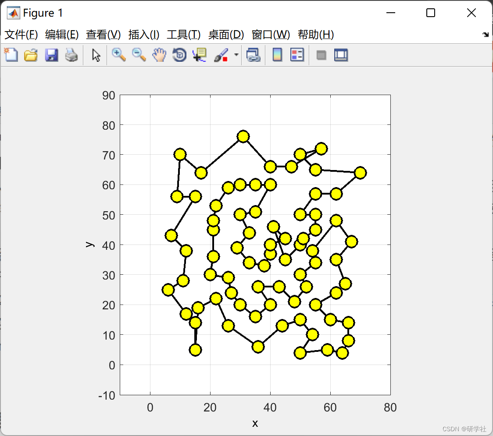
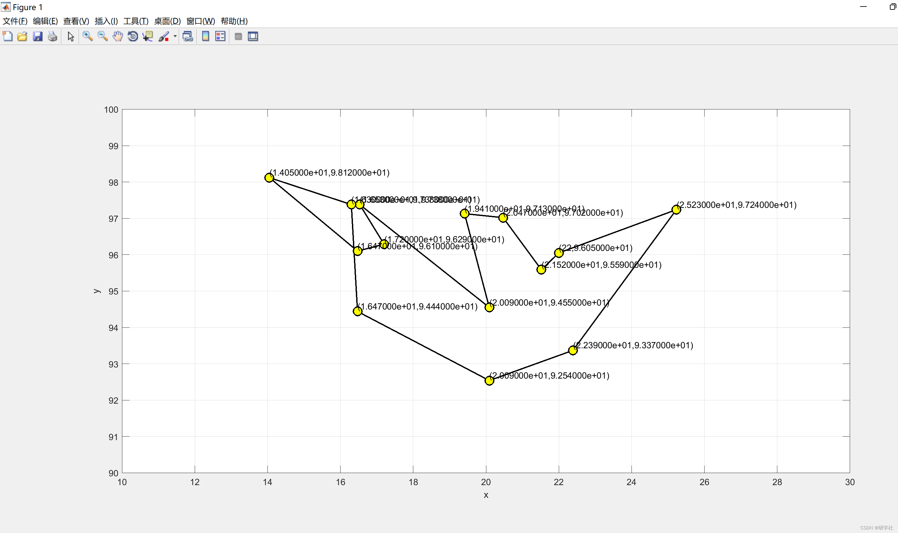
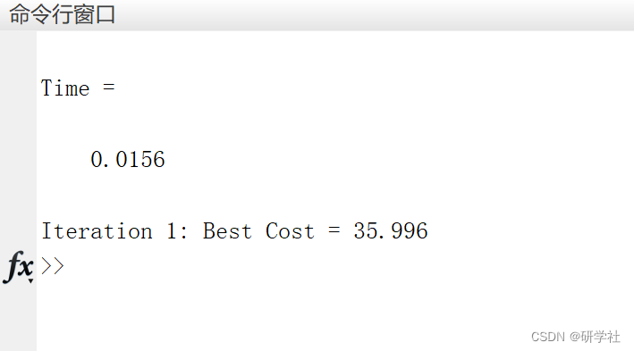

# Improved Ant Colony Optimization (NACO) for solving TSP Problems (Matlab code implementation)

The algorithm aimed at obtaining precise solutions with factor complexity is categorized as NP-Complete. Heuristic methods' solutions are either based on optimization problems. These algorithms have lesser complexity than exact ones. Therefore, they provide solutions in less time and space, and use them when approximate solutions are sufficient, especially when exact solutions are very difficult to achieve.
The first aim of this paper is to emphasize the requirements, limitations, and functions of each TSP method to guide scientists and researchers in selecting the most suitable method for their specific needs. It conducts a comprehensive survey of the most effective and widely used TSP methods, clarifying their main differences through research that aims to identify their strengths and weaknesses.
Ant Colony Optimization (ACO) considers a heuristic method with the ability to reach the best TSP solution. It originates from the natural behavior of ants in nature - based on analyzing how real ants think about searching and storing food in the colony. The second aim of this paper is to propose a new hybrid algorithm to solve TSP. It combines the structure of ACO with the Neighbor Joining (NJ) approach, and calls it (NACO). The new algorithm pays close attention to all possible factors that can influence the solution and applies them to TSP. By comparing them with the original algorithm of the ant colony, especially in terms of reducing computation and time, it makes many improvements to the solution.
The article also introduces parallel NACO as an efficient parallel program for high-performance TSP. It is recommended to run Ant in separate execution threads to benefit from the independent operations of each ant and to implement parallel algorithms using multicore systems. The proposed program is programmed in MATLAB® R2017a (version 9.2) and implemented on a HP computer with 8GB RAM and an Intel Core i7-8565U CPU, 64-bit Windows operating system. The results show that compared to NACO, the complexity is reduced to O(n^2(n-ω)). To PNACO, the complexity is reduced from O(n(n⁄p)(n-ω)), and the acceleration reaches up to 10.
📚2 Run Results Edit
​Edit
​Edit
Part of the code:
%% Parameters
Iteration=1;             % No. of Iterations
no_ant=1;              % Population Size (No. of Ants)
Q=100;  
%t0=1;  
t0=10*Q/(no_Var*mean(D_Set.D(:)));   % Initial Phromone
alpha=1;                % Phromone Exponential Weight
beta=5;                % Heuristic Exponential Weight
rate=0.7;               % Evaporation Rate
%% Initialization
eta=1./D_Set.D;            % Heuristic Information Matrix  
t=t0*ones(no_Var,no_Var);       % Phromone Matrix  
BC=zeros(Iteration,1);         % Array to Hold Best Cost Values  
% Empty Ant  
empty_ant.Tour=[];  
empty_ant.Cost=[];  
% Ant Colony Matrix  
ant=repmat(empty_ant,no_ant,1);  
% Best Ant  
BS.Cost=inf;  
% the Level_one of NJ  
Leaf=Leaf_1(D_Set.D);  
% Runtime  
T_1 = cputime;  
%% NEW_ACO Main Program  
for it=1:Iteration  
for k=1:no_ant           % Move Ants  
Leaf1=Leaf;  
ant(k).Tour=randi([1 no_Var]); %% {choose a random non visited city}  
city=ant(k).Tour;  
for l =2:no_Var  
ant_tour=ant(k).Tour(end);  
[row,col] = find(Leaf1==city);  
if isempty(row)  
P=t(ant_tour,:).^alpha.*eta(ant_tour,:).^beta;  
P(ant(k).Tour)=0;  
P=P/sum(P);  
city=RouletteSelection(P);  
ant(k).Tour=[ant(k).Tour city];  
else  
l=l+1;         % Pass the joining cities  
if col==2  
city=Leaf1(row,1);  
else  
city=Leaf1(row,2);  
end  
ant(k).Tour=[ant(k).Tour city];  
Leaf1(row,1)=0;  
Leaf1(row,2)=0;  
end  
% ant(k).Tour=[ant(k).Tour city];  
end  
ant(k).Cost=CostFunction(ant(k).Tour);  
if ant(k).Cost<BS.Cost  
BS=ant(k);  
end  
end  
% Update Phromones  
for k=1:no_ant  
tour=ant(k).Tour;  
tour=[tour tour(1)];  
for ll=1:no_Var  
ant_tour=tour(ll);  
city=tour(ll+1);  
t(ant_tour,city)=t(ant_tour,city)+Q/ant(k).Cost;  
end  
end  
% Evaporation  
t = (1 - rate) * t;  
% Store Best Cost  
BC(it) = BS.Cost;  
🎉3 References  
🌈4 Matlab Code Implementation

## Images

<!-- PAYMENT_BLOCK -->

## Get this dataset

- Payment link (Stripe): [Buy now](https://buy.stripe.com/3cs8yP7sY87d0vu9AB)
- Payment QR code: 

<!-- /PAYMENT_BLOCK -->
